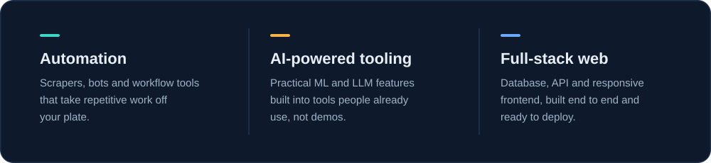

  
 
    
 
  

Tech stack

         

Work with me

Open to full-time, part-time and freelance work. If you have a manual process that should not be manual, write to me at canemircan973@gmail.com.
